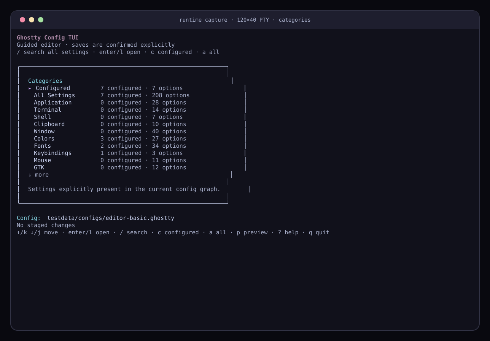
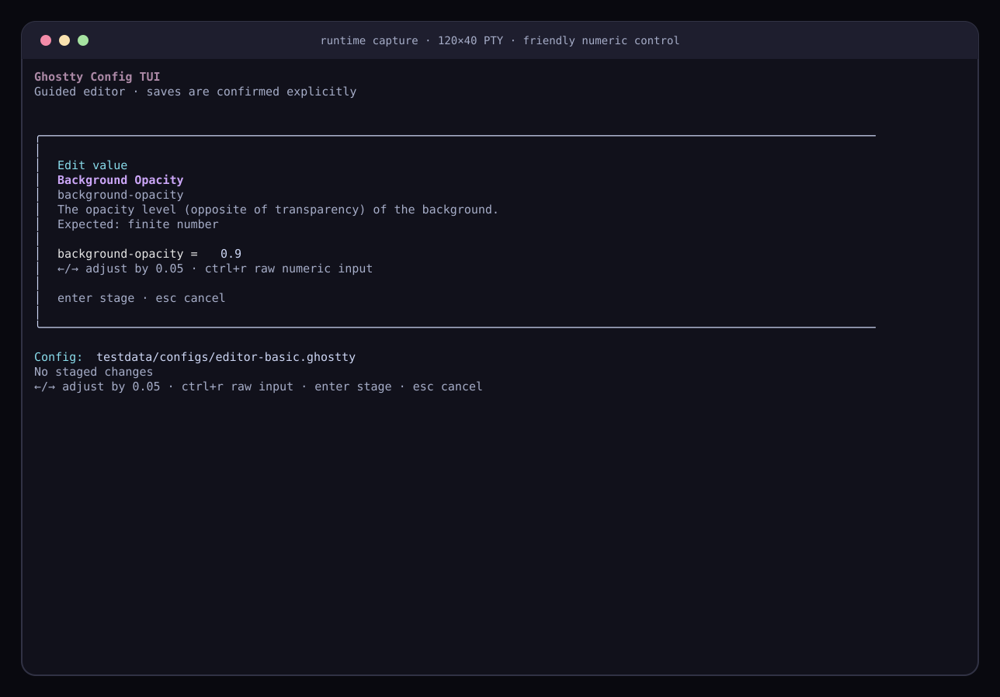
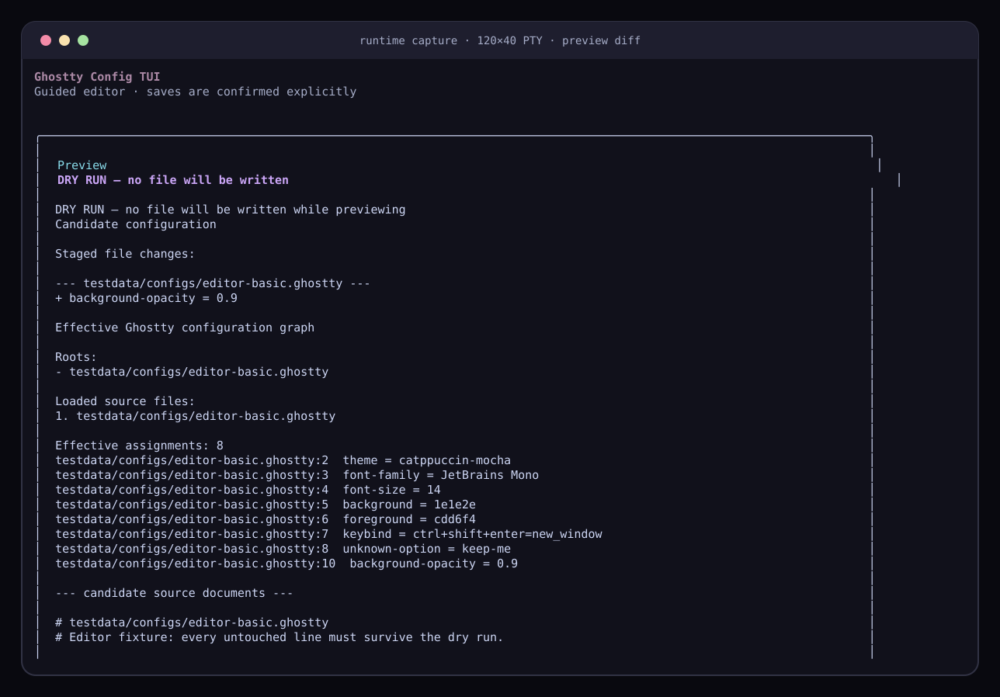

# Ghostty Config TUI

A terminal user interface for configuring [Ghostty](https://ghostty.org/)
without requiring users to memorize the raw configuration syntax.

This module lives in the Ghostty fork. The macOS fork build bundles the editor
and generates its settings catalog from the Ghostty executable in the same app.
Open it from **Settings…** in the Ghostty menu bar.

## Project goal

Make Ghostty configuration discoverable, safe, and approachable while keeping
the user's existing config intact.

## See it in action

The full settings editor uses category-first navigation, then chooses the
right control for each setting instead of making every value a text field.

<p align="center">
  
  
</p>
<p align="center">
  
</p>

These captures come from the real binary running in a 120×40 PTY; they are
not hand-drawn UI mockups.

## Current behavior

- Load the user's Ghostty config from its standard location.
- Browse and search settings by category.
- Edit values with controls appropriate to their type.
- Validate values before saving.
- Preview the resulting diff.
- Preserve comments and options the application does not yet understand.
- Create a backup before writing changes.
- Notify the hosting Ghostty process to reload after a successful save, when
  the app host supplies `GHOSTTY_SETTINGS_RELOAD_PID`.
- Undo the most recent successful save in the current editor session with
  `ctrl+z`, provided the files have not changed externally and there are no
  unsaved drafts. Undo restores the prior bytes and leaves `.bak` files intact.

## Run the editor

With no arguments, the app reads all existing default Ghostty config files,
follows their `config-file` includes, and shows the effective values with
source locations:

```sh
cd settings
go run ./cmd/ghostty-config-tui
```

Use `--config PATH` when you want to select a specific existing file instead:

```sh
go run ./cmd/ghostty-config-tui --config testdata/configs/editor-basic.ghostty
```

The default root lookup order follows [Ghostty's configuration
docs](https://ghostty.org/docs/config):

1. `$XDG_CONFIG_HOME/ghostty/config.ghostty`
2. `$XDG_CONFIG_HOME/ghostty/config`
3. On macOS, `~/Library/Application Support/com.mitchellh.ghostty/config.ghostty`
4. On macOS, `~/Library/Application Support/com.mitchellh.ghostty/config`

When `XDG_CONFIG_HOME` is unset, `$HOME/.config` is used. The legacy
`config` filename remains supported. The graph preserves root and include
precedence, reports missing optional/required files and cycles, and never
flattens source documents into a file to write. If no root file exists, it
reports the checked paths and suggests `--config PATH`; it does not create a
config file.

When launched by the app host, the first screen is an appearance playground:
it shows the current theme and an explicitly labeled in-app color preview,
then lets you browse and search Ghostty's available themes. Moving through the
inventory updates only the candidate preview; `enter` stages a theme in
memory, and an explicit save is still required to write it. Theme colors are
read from Ghostty's own theme data when available. Missing Ghostty/theme data
is shown as unavailable rather than replaced with guessed colors. The preview
does not reload Ghostty or render the configured font.

Choose `Full settings editor · Categories` from that home to open the
category-first editor instead of dumping the whole catalog at once. Start with
`Configured` to see only settings present in the loaded config, choose a
category such as `Colors`, `Fonts`, or `Window`, or open `All Settings` when
you deliberately need the complete catalog. Use `↑`/`k` and `↓`/`j` to browse
categories, `enter`/`l` to open one, `esc`/`h` to go back, `c` for configured
settings, `a` for all settings, and `/` for global search. Inside an option
list, `enter` or `e` edits the selected option, `r` stages a default reset,
`u` reverts a staged option, `p` previews, and `ctrl+s` saves. Press `q`, then
`y`, to save and quit; `d` discards the staged changes and quits.
After a successful save, use `ctrl+z` to undo it while the editor remains
open. Undo checks that every changed file still contains the bytes written by
that save; if any file changed externally, the editor reports the conflict and
keeps the undo available for retry.

Scalar options use reviewed controls: visible inherit/off/on toggles, numeric
steppers, documented enum pickers, multi-select lists, duration/unit pickers,
metric and resource-limit editors, path browsers, and friendly
theme/color/font choosers where an inventory is available. Repeatable options
such as `font-family`, `palette`, `env`,
`keybind`, and `config-file` open a list editor where each occurrence can be
added, changed, or removed. Pair settings use forms for keys and values;
keybindings and command-palette entries expose trigger/action fields. Press
`ctrl+r` inside any friendly control when you need the raw Ghostty value for a
custom or version-specific case.
For duplicate scalar assignments, the editor targets the effective source
line and displays its file and line number. New values are added to the
selected root when no source assignment exists.

The editor keeps one draft per root/include file. Preview shows the exact
per-file candidate changes and the resulting effective graph. Saving checks
that every source is unchanged, writes a `.bak` backup, and atomically replaces
all changed files; Ghostty's own validator is also run for a single-file
candidate when the Ghostty binary is available. Loading never creates or
writes a file.

Architecture and implementation decisions are recorded in
[`docs/tech-stack.md`](docs/tech-stack.md).

The friendly-control roadmap is in
[`docs/plan-friendly-controls.md`](docs/plan-friendly-controls.md).
